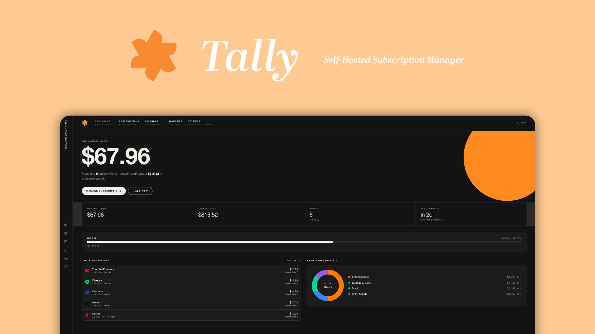

# Tally

**Tally** is a self-hostable subscription management dashboard.
Manage the cost, billing cycle, renewal dates, and monthly/yearly totals of
your subscriptions all in one place, on a server you own. Access it from any
web browser, and get up and running easily with Docker.

## Key features

- **Multi-user** — each account manages its own subscriptions, categories, and settings
- **Free trial tracking** — alerts before the first charge
- **Multi-currency** — automatic conversion to your main currency
- **Monthly budget** — budget bar and over-budget alerts
- **Notifications** — sends upcoming payment reminders to Discord / email / generic webhook / Slack / ntfy. Built-in scheduler sends automatically every day (no cron required)
- **iCal integration** — subscribe to payment dates from your calendar app
- **Calendar** view, **statistics**, search & filter, subscription duplication
- **Per-user language & theme** — Japanese / English, dark / light
- **Self-hosted** — data is stored only in SQLite on your server, with automatic backups
- **Update notification** — an in-app banner when a new version is released

## Quick links

- [Getting Started](getting-started.md) — launch with Docker + configure environment variables
- [Configuration](configuration.md) — in-app (per-user) settings
- [Features](features.md) — what Tally can do
- [Notifications](notifications.md) — Discord / email / webhook / Slack / ntfy
- [Self-Hosting](self-hosting.md) — updates, backups, security
- [FAQ](faq.md)
