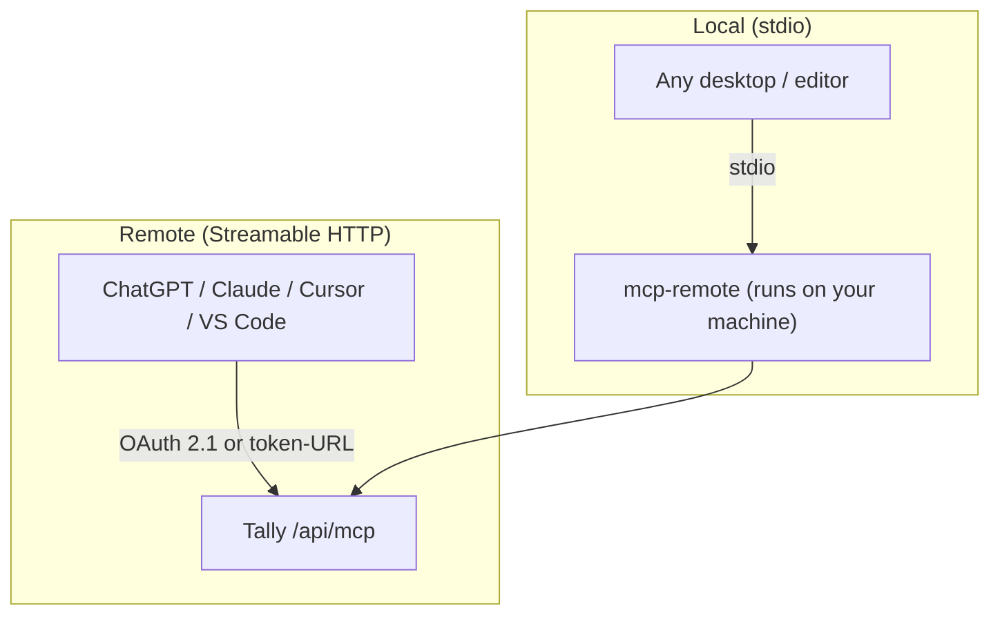

# MCP integration

Tally exposes a Streamable HTTP MCP server at `/api/mcp`. An AI assistant can
read the signed-in user's subscriptions and, with OAuth write access, manage
them and their categories and payment methods.

!!! note "Available in development builds"
    Check the version running on your Tally instance for tool availability.

## Read tools

| Tool | What it does |
| --- | --- |
| `list_subscriptions` | Search by name (`q`), category, payment method, status, or normalized monthly cost. Sort by name, cost, or next payment. |
| `get_subscription` | Get one subscription by ID. |
| `get_totals` | Get monthly and annual spending totals and budget status. |
| `get_upcoming_payments` | Get the next scheduled charge per active subscription within the given number of days. |
| `get_payment_schedule` | Get every scheduled charge and the converted total in an inclusive `start`–`end` date range of up to 366 days. |
| `get_subscription_reminders` | Find trial end dates and review deadlines. Filter with `kind: "trial"` or `kind: "review"`. |
| `get_spend_breakdown` | Get normalized monthly and yearly spending by category or payment method. |
| `list_categories` / `list_payment_methods` | List categories and payment methods. |
| `preview_subscription_import` | Preview up to 500 CSV or JSON records. Reports ready records, duplicate names, and validation errors without saving. |

## Write tools

Approve `tally:write` on the OAuth consent screen to use these tools.

| Tool | What it does |
| --- | --- |
| `create_subscription` | Register a subscription. |
| `update_subscription` | Update only the supplied fields. |
| `toggle_subscription` | Pause or resume a subscription. |
| `duplicate_subscription` | Create a copy of an existing subscription. |
| `manage_subscription_label` | Add, rename, or delete a category or payment method. Renames update linked subscriptions. Deleting a label in use requires an existing replacement. |

Deleting a subscription is available through the [REST API](rest-api.md).

## Before you start

### 1. Generate an API key

In **Settings → MCP integration**, click **Generate API key**. Three connection
values are then shown (see below).

### 2. Choose remote vs local

MCP has two families: **remote** (over the internet) and **local** (a bridge you
run on your own machine).



- **Remote** means the AI service connects *to* Tally, so **public HTTPS is
  required** (see [Exposing over HTTPS](#https)). ChatGPT and claude.ai (web) use this.
- **Local** runs `mcp-remote` on your own machine, so **no public exposure is
  needed** — it works even for a tailnet/LAN-only Tally (and for OAuth-less
  clients like Windsurf).

### 3. Three connection methods

How to use the values shown in **Settings → MCP integration**:

1. **OAuth clients** (ChatGPT, connectors) — register the endpoint
   `https://<host>/api/mcp`; the client **signs you in to authorize**.
2. **Token-in-URL** (simple connectors with no auth field) — paste
   `https://<host>/api/mcp/<API key>` into the URL field.
3. **API key (Bearer)** (Claude Code / mcp-remote) — `Authorization: Bearer <API key>`.

!!! info "Read vs write"
    **Only method 1 (OAuth) can write** — when you approve `tally:write` on the
    consent screen. **Methods 2 and 3 (token-URL / Bearer) are read-only.**

## Connect over a LAN or Tailscale

A client running on your device can connect directly if it supports Streamable
HTTP, allows HTTP for the target, and can send a Bearer header. Use an endpoint
such as `http://192.168.1.20:6400/api/mcp` or
`http://100.x.x.x:6400/api/mcp` with the read key. This setup needs no custom
domain. For OAuth, use an HTTPS endpoint and configure the proxy to forward the
public host and scheme consistently.

## Per-client setup

=== "ChatGPT"

    **Requirements:** public HTTPS + OAuth (ChatGPT mandates Dynamic Client
    Registration; bearer tokens and token-URLs are not accepted).

    1. **Settings → Apps & Connectors → Add custom connector**.
    2. Enter the **URL** `https://<host>/api/mcp`.
    3. On adding, Tally's login/consent screen opens — sign in and **Approve**.

=== "Claude Desktop / web"

    **Using the custom-connector UI** (OAuth):

    1. **Settings → Connectors → Add custom connector**.
    2. Enter `https://<host>/api/mcp` → sign in and **Approve**.

    To skip OAuth, paste the **token-in-URL**
    `https://<host>/api/mcp/<API key>` into the URL field and leave the OAuth
    fields blank.

    !!! note "Free tier is local-only"
        The claude.ai free tier does not support remote MCP. Use the **Local**
        tab (`mcp-remote`).

=== "Claude Code"

    ```bash
    # API key (Bearer)
    claude mcp add --transport http tally https://<host>/api/mcp \
      --header "Authorization: Bearer <API key>"

    # or OAuth (browser sign-in)
    claude mcp add --transport http tally https://<host>/api/mcp
    ```

    Claude Code connects directly from your machine, so **tailnet / LAN /
    localhost URLs work as-is** (no public exposure needed).

=== "Cursor / VS Code"

    Add `https://<host>/api/mcp` as a remote MCP server (both support native
    OAuth; VS Code needs GitHub Copilot 1.101+). Without public HTTPS, use the
    **Local** tab.

=== "Local (mcp-remote)"

    Works with any desktop/editor client, and with a **non-public Tally
    (tailnet/LAN)**. Add this to the client's config file (e.g. Claude Desktop's
    `claude_desktop_config.json`):

    ```json
    {
      "mcpServers": {
        "tally": {
          "command": "npx",
          "args": ["-y", "mcp-remote", "https://<host>/api/mcp/<API key>"]
        }
      }
    }
    ```

    `mcp-remote` **runs on your machine** and connects out to Tally over HTTPS.
    Requires Node.js / npx. **Fully restart** the app after editing the config.

## Exposing over HTTPS { #https }

ChatGPT and claude.ai (web) connectors connect **from the vendor's servers**, so
your instance must be reachable from the internet over HTTPS (the same as
exposing the web UI). Common options:

- **Cloudflare Tunnel** — public custom domain, no open ports. Free.
- **Reverse proxy + Let's Encrypt** (Caddy / nginx) + your own domain.
- **Tailscale Funnel** — publish a `.ts.net` host over HTTPS.

!!! danger "Security when public"
    Once public, **anyone who knows a token-in-URL can read your data** (the URL
    is the secret). The OAuth method keeps no secret in the URL. If you can't
    restrict access, prefer OAuth. For clients that connect locally
    (Desktop/editors), the **Local** method avoids exposing anything.

!!! important "Set a stable SESSION_SECRET"
    OAuth tokens and login sessions are signed with `SESSION_SECRET`. If it's
    unset, a random secret is generated per process and **everyone must
    re-authorize / re-login on every restart**. Set a stable value for
    production (see [Configuration](configuration.md)).

## Troubleshooting

- **"Couldn't connect to the server"** (connector) — check the URL is
  **reachable over public HTTPS**. A tailnet/LAN-only URL is not reachable from
  claude.ai (web) or hosted connectors; use the **Local (mcp-remote)** method.
- **Can't add it in ChatGPT** — ChatGPT requires OAuth + Dynamic Client
  Registration. Token-URL and Bearer won't work; register the endpoint
  `.../api/mcp`.
- **Re-login required after every restart** — `SESSION_SECRET` is unset. Set a
  stable value.
- **Tools don't appear** (mcp-remote) — fully restart the app; the first run may
  take a few seconds to download `npx`.

## Security & revocation

- MCP write tools require OAuth with `tally:write`. Bearer API-key and token-in-URL connections are read-only. The separate REST write key is scoped to REST.
- Access tokens are short-lived (1 hour by default); refresh tokens rotate on
  every use.
- **Revoking the API key** disables token-URL / Bearer connections made with it
  (**Settings → MCP integration → Revoke API key**).
