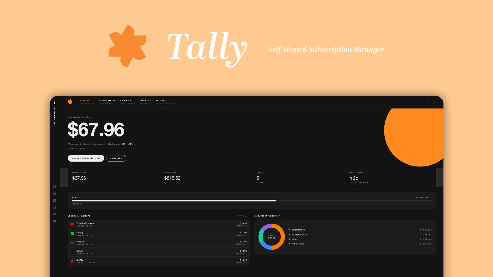

# Tally

**Tally** は、セルフホスト可能なサブスクリプション管理ダッシュボードです。
契約中のサブスクの料金・請求サイクル・更新日・月額/年額の合計を、自分の
サーバー上で一元管理できます。Web ブラウザからアクセスでき、Docker で簡単に
起動できます。

## 主な特長

- **マルチユーザー** — アカウントごとにサブスク・カテゴリ・設定を個別管理
- **無料トライアル管理** — 初回課金の前にアラート
- **多通貨対応** — メイン通貨へ自動換算
- **月間予算** — 予算バーと予算超過アラート
- **通知** — 支払い予定を Discord / メール / 汎用 Webhook / Slack / ntfy に通知。内蔵スケジューラーで毎日自動送信（cron 不要）
- **iCal 連携** — 支払い日をカレンダーアプリで購読
- **カレンダー**表示、**統計**、検索・フィルタ、サブスクの複製
- **ユーザーごとの言語・テーマ** — 日本語 / English、ダーク / ライト
- **セルフホスト** — データはサーバー内の SQLite にのみ保存、自動バックアップ付き
- **アップデート通知** — 新バージョンが出るとアプリ内バナーで通知

## クイックリンク

- [はじめに](getting-started.md) — Docker で起動＋環境変数の設定
- [設定](configuration.md) — アプリ内（ユーザーごと）の設定
- [機能](features.md) — Tally でできること
- [通知](notifications.md) — Discord / メール / Webhook / Slack / ntfy
- [セルフホスト](self-hosting.md) — 更新・バックアップ・セキュリティ
- [よくある質問](faq.md)
