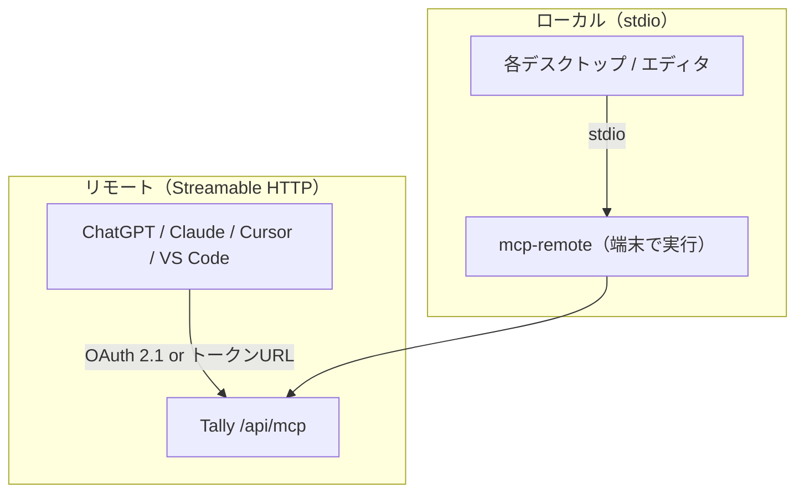

# MCP 連携

Tally は `/api/mcp` で Streamable HTTP の MCP サーバーを提供します。AI アシスタントから自分のサブスクリプション情報を参照でき、OAuth で書き込みを許可すると、サブスクやカテゴリ、支払い方法も管理できます。

!!! note "開発版の機能を含みます"
    実際に使えるツールは、接続先の Tally のバージョンで確認してください。

## 読み取りツール

| ツール | 内容 |
| --- | --- |
| `list_subscriptions` | 名前（`q`）、カテゴリ、支払い方法、稼働状態、月額換算料金で絞り込み。名前順・料金順・次回支払日順に並べ替え。 |
| `get_subscription` | ID を指定してサブスクを 1 件取得。 |
| `get_totals` | 月額・年額の支出合計と予算状況を取得。 |
| `get_upcoming_payments` | 指定日数以内の次回支払いを有効なサブスクごとに取得。 |
| `get_payment_schedule` | `start`〜`end` の最大 366 日間に発生するすべての請求予定と換算合計を取得。 |
| `get_subscription_reminders` | トライアル終了日と見直し期限を取得。`kind: "trial"` または `kind: "review"` で絞り込み。 |
| `get_spend_breakdown` | カテゴリ別または支払い方法別の月額・年額換算を取得。 |
| `list_categories` / `list_payment_methods` | カテゴリと支払い方法の一覧。 |
| `preview_subscription_import` | CSV・JSON を最大 500 件検証。登録可能な行、同名の重複候補、入力エラーを保存せずに確認。 |

## 書き込みツール

OAuth の同意画面で `tally:write` を許可すると、以下のツールが使えます。

| ツール | 内容 |
| --- | --- |
| `create_subscription` | サブスクを新規登録。 |
| `update_subscription` | 指定した項目だけを編集。 |
| `toggle_subscription` | サブスクを停止または再開。 |
| `duplicate_subscription` | 既存サブスクを複製して新規登録。 |
| `manage_subscription_label` | カテゴリや支払い方法の追加・名前変更・削除。名前変更は関連サブスクにも反映され、使用中の項目を削除するには既存の移行先が必要。 |

サブスクそのものの削除は [REST API](rest-api.md) から行えます。

## 事前準備

### 1. API キーを生成

**設定 → MCP 連携** で **API キーを生成**します。生成後、3 種類の接続情報が
表示されます（後述）。

### 2. 接続経路を選ぶ

MCP には **リモート**（インターネット越し）と **ローカル**（あなたの端末で動かす
中継）の 2 系統があります。



- **リモート**は AI サービス側から Tally に接続するため、**公開 HTTPS が必須**です
  （[公開する](#https)を参照）。ChatGPT や claude.ai（web）はこちら。
- **ローカル**は `mcp-remote` をあなたの端末で動かして中継するため、**公開は不要**。
  tailnet や LAN 内だけの Tally でも使えます（Windsurf など OAuth 非対応クライアント
  もこちら）。

### 3. 接続方式は 3 つ

**設定 → MCP 連携** に表示される URL/キーの使い分け:

1. **OAuth 対応クライアント**（ChatGPT・各コネクタ）… エンドポイント
   `https://<host>/api/mcp` を登録 → **ログイン画面で認可**。
2. **トークン埋め込み URL**（認証 UI のない簡易コネクタ）…
   `https://<host>/api/mcp/<API キー>` を URL 欄に貼る。
3. **API キー（Bearer）**（Claude Code / mcp-remote）… `Authorization: Bearer <API キー>`。

!!! info "読み取り／書き込み"
    **① OAuth のみ書き込み可**（同意画面で `tally:write` を許可した場合）。
    **②③（トークン URL / Bearer）は読み取り専用**です。

## LAN・Tailscale から接続

手元の端末で動くクライアントが Streamable HTTP と HTTP URL、Bearer ヘッダーに対応していれば、`http://192.168.1.20:6400/api/mcp` や `http://100.x.x.x:6400/api/mcp` に読み取りキーで接続できます。独自ドメインは不要です。OAuth で接続する場合は HTTPS を使い、リバースプロキシから接続先のホスト名とスキームを正しく転送してください。

## クライアント別の手順

=== "ChatGPT"

    **必要要件:** 公開 HTTPS ＋ OAuth（ChatGPT は動的クライアント登録が必須で、
    Bearer やトークン URL は使えません）。

    1. **設定 → コネクタ（Apps & Connectors）→ カスタムコネクタを追加**。
    2. **URL** に `https://<host>/api/mcp` を入力。
    3. 追加すると Tally のログイン／認可画面が開くので、ログインして**許可**。

=== "Claude Desktop / web"

    **カスタムコネクタUIを使う場合**（OAuth）:

    1. **設定 → コネクタ → カスタムコネクタを追加**。
    2. **URL** に `https://<host>/api/mcp` を入力 → ログインして**許可**。

    OAuth を使わず簡単に繋ぎたい場合は、URL 欄に
    **トークン埋め込み URL** `https://<host>/api/mcp/<API キー>` を貼り、OAuth 欄は
    空のままにします。

    !!! note "無料プランはローカルのみ"
        claude.ai の無料プランはリモート MCP に非対応です。**ローカル**タブの
        `mcp-remote` 方式を使ってください。

=== "Claude Code"

    ```bash
    # API キー（Bearer）
    claude mcp add --transport http tally https://<host>/api/mcp \
      --header "Authorization: Bearer <API キー>"

    # または OAuth（ブラウザでログイン認可）
    claude mcp add --transport http tally https://<host>/api/mcp
    ```

    Claude Code は端末から直接接続するため、**tailnet / LAN / localhost の URL でも
    そのまま使えます**（公開不要）。

=== "Cursor / VS Code"

    リモート MCP サーバーとして `https://<host>/api/mcp` を追加します（どちらも
    ネイティブ OAuth 対応。VS Code は GitHub Copilot 1.101 以降）。公開 HTTPS が
    無い場合は**ローカル**タブの方式を使ってください。

=== "ローカル（mcp-remote）"

    どのデスクトップ／エディタでも、また **公開していない Tally（tailnet/LAN）**でも
    使える方式です。設定ファイル（例: Claude Desktop の `claude_desktop_config.json`）
    に以下を追加します:

    ```json
    {
      "mcpServers": {
        "tally": {
          "command": "npx",
          "args": ["-y", "mcp-remote", "https://<host>/api/mcp/<API キー>"]
        }
      }
    }
    ```

    `mcp-remote` は**あなたの端末で実行**され、そこから Tally へ HTTPS 接続します。
    Node.js / npx が必要です。設定後はアプリを**完全に再起動**してください。

## 公開 HTTPS 化 { #https }

ChatGPT や claude.ai（web）のコネクタは **Anthropic / OpenAI 側から** Tally に
接続するため、インスタンスをインターネットから HTTPS で到達可能にする必要が
あります（Web UI を公開するのと同じ作業）。代表的な手段:

- **Cloudflare Tunnel** — ポート開放不要で独自ドメインに公開。無料。
- **リバースプロキシ ＋ Let's Encrypt**（Caddy / nginx）＋ 独自ドメイン。
- **Tailscale Funnel** — `.ts.net` を公開 HTTPS 化。

!!! danger "公開時のセキュリティ"
    公開すると、**トークン埋め込み URL を知る者は誰でも読み取れます**（URL 自体が
    鍵）。OAuth 方式なら URL に秘密は乗りません。公開範囲を絞れない場合は OAuth を
    推奨します。到達できれば十分な用途（Desktop/エディタ）では**ローカル方式**で
    公開を避けられます。

!!! important "SESSION_SECRET を固定する"
    OAuth のトークンとログインセッションは `SESSION_SECRET` で署名されます。値を
    設定しないとプロセスごとにランダム生成され、**再起動のたびに再認可・再ログイン**
    が必要になります。安定運用には必ず設定してください（[設定](configuration.md)参照）。

## トラブルシュート

- **「サーバーに接続できませんでした」**（コネクタ）… URL が**公開 HTTPS で到達可能**
  か確認。tailnet / LAN 限定の URL は claude.ai（web）や各コネクタからは届きません。
  その場合は**ローカル（mcp-remote）**方式へ。
- **ChatGPT で追加できない** … ChatGPT は OAuth＋動的クライアント登録が必須です。
  トークン URL や Bearer では追加できません。エンドポイント `.../api/mcp` を登録して
  ください。
- **再起動後に再ログインを求められる** … `SESSION_SECRET` が未設定です。固定値を
  設定してください。
- **ツールが出てこない**（mcp-remote）… アプリを完全に再起動。初回は `npx` の
  ダウンロードで数十秒かかることがあります。

## セキュリティと失効

- MCP の書き込みには `tally:write` を許可した OAuth 接続が必要です。Bearer API キーとトークン URL は読み取り専用です。REST API 書き込みキーは REST 専用です。
- アクセストークンは短命（既定 1 時間）、リフレッシュトークンは使用のたびに
  ローテーションされます。
- **API キーを失効**すると、そのキーによるトークン URL / Bearer 接続は無効になります
  （**設定 → MCP 連携 → API キーを失効**）。
