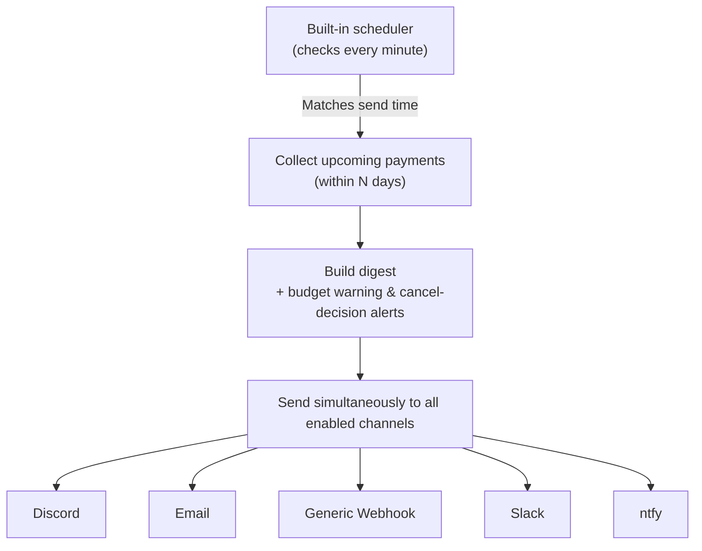

# Notifications

Tally can send a daily digest of your **upcoming payments** (plus trial-ending,
over-budget, and cancel-decision alerts) to multiple channels. Timing is
handled by the built-in scheduler, so no cron is required.

Supported channels: **Discord** · **email (SMTP)** · **generic webhook** ·
**Slack** · **ntfy**. Each is configured per-user, and you can enable several
at once.

## How it works



- The scheduler checks every minute and, once a day at your configured
  **send time** (based on the container's timezone), sends upcoming payments
  within the **days-before** range you set.
- Notifications go out simultaneously to every channel you've configured.
- Timing follows the container's `TZ` (default `Asia/Tokyo`).
- If you've set a **monthly budget** and the projected total exceeds it, a
  warning is added to the notification.
- If you've set a **cancel-decision reminder** for a subscription, a
  "Consider canceling" section is included in the notification a set number
  of days before renewal.

The send time and days-before range are set once, in **Settings →
Notifications**, and apply to all channels.

## Discord

1. In Discord, go to **Channel Settings → Integrations → Webhooks → New
   Webhook** and copy the URL.
2. Paste it into the **Discord Webhook URL** field under **Settings →
   Notifications → Discord** in Tally.
3. Turn on "Automatically send Discord notifications of upcoming payments at
   this time every day."
4. Use "Send test now" to verify it works (this sends to all enabled
   channels).

!!! note "Any http(s) webhook URL is allowed"
    This used to be restricted to the `https://discord.com/api/webhooks/...`
    format. To support proxies and Discord-compatible endpoints, Tally now
    accepts any well-formed **http(s) URL** (only malformed URL strings are
    rejected). You're responsible for managing the destination.

## Email (SMTP)

Email notifications can be configured with **per-user** SMTP settings. Under
**Settings → Notifications → Email**:

1. Enter the **recipient email address** and turn on "Also send upcoming
   payments by email."
2. Fill in the **SMTP server settings** below it (host / port / username /
   password / from address).
3. Use "Send test now" to verify it works.

If per-user SMTP isn't configured, the server's environment variables are
used as a fallback. These aren't included in the default
`docker-compose.yml`, so add them only if you need a server-wide fallback:

```yaml
environment:
  SMTP_HOST: "smtp.example.com"
  SMTP_PORT: "587"        # 587 = STARTTLS, 465 = implicit TLS
  SMTP_USER: "you@example.com"
  SMTP_PASS: "app-password"   # most providers require an app password
  SMTP_FROM: "Tally <you@example.com>"
```

If neither is configured, email is skipped.

!!! note "Handling of passwords"
    Saved SMTP passwords and access tokens are never displayed again in the
    browser (the settings screen shows a placeholder). Only enter a new value
    when you want to change it.

## Generic webhook

POSTs upcoming payments as **JSON** to any URL. Handy for integrating with
Zapier, IFTTT, n8n, and similar tools.

1. Enter the **Webhook URL** under **Settings → Notifications → Generic
   Webhook** and enable it.
2. Example payload sent:

```json
{
  "source": "tally",
  "event": "upcoming_payments",
  "daysBefore": 3,
  "count": 2,
  "currency": "USD",
  "monthlyTotal": 62.90,
  "budget": null,
  "title": "2 payments due within 3 days",
  "items": [ { "name": "Netflix", "price": "$15.49", "dateLabel": "…", "trial": false } ],
  "reviewItems": []
}
```

!!! info "Private-network destinations are allowed too"
    Since sending to n8n, ntfy, Gotify, and similar services on your home
    network is a legitimate use case, the generic webhook and ntfy channels
    also allow sending to private addresses. You're responsible for managing
    the destination (Slack is restricted to `hooks.slack.com` only).

## Slack

Sends to a Slack **Incoming Webhook**.

1. Create a Slack app, enable **Incoming Webhooks**, and issue a webhook URL
   for the channel (`https://hooks.slack.com/services/...`).
2. Paste it into **Settings → Notifications → Slack** and enable it.

## ntfy

Delivers **push notifications** to your smartphone (via
[ntfy.sh](https://ntfy.sh) or your own server).

1. Enter your **ntfy topic URL** (e.g. `https://ntfy.sh/your-topic`) under
   **Settings → Notifications → ntfy** and enable it.
2. Optionally set an **access token**, if needed.
3. Subscribe to the same topic in the ntfy app on your phone.

## Optional: cron endpoint

A per-user, token-authenticated endpoint is also available for external
schedulers (not normally needed, since Tally has a built-in scheduler):

```bash
curl "http://host:6400/api/notify?token=YOUR_TOKEN"
```
