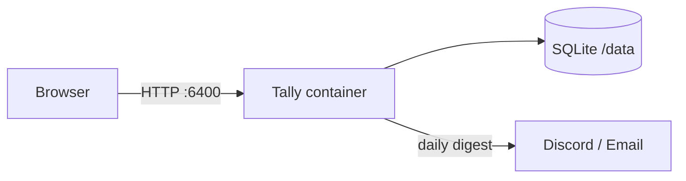

# Getting started

Tally runs as a single Docker container. Data is stored in SQLite on a mounted
volume, so it survives restarts and updates.

## Prerequisites

- [Docker](https://docs.docker.com/get-docker/) with the Compose plugin
- A machine you control (a home server, VPS, or your own laptop)

## Run with Docker Compose

```bash
# 1. Clone the repository
git clone https://github.com/CubeZeero/Tally.git
cd Tally

# 2. (Recommended) set a strong session secret in a git-ignored .env
echo "SESSION_SECRET=$(openssl rand -base64 32)" >> .env

# 3. Build & start
docker compose up -d --build
```

Open <http://localhost:6400>. On first run you'll create an account
(username + password). Your data is stored only on your server.

!!! tip "First account"
    The first account you create claims any pre-existing data. After that, set
    `DISABLE_REGISTRATION=1` if you want to stop further sign-ups. See
    [Configuration](configuration.md).

## Run with `docker run`

```bash
docker build -t tally .
docker run -d \
  --name tally \
  -p 6400:6400 \
  -e SESSION_SECRET="$(openssl rand -base64 32)" \
  -e TZ="Asia/Tokyo" \
  -v tally-data:/data \
  tally
```

## What you get



## Next steps

- Add your subscriptions from the dashboard
- Set your **main currency** and, optionally, **notifications** in Settings
- Read [Self-hosting](self-hosting.md) for updates, backups, and security
